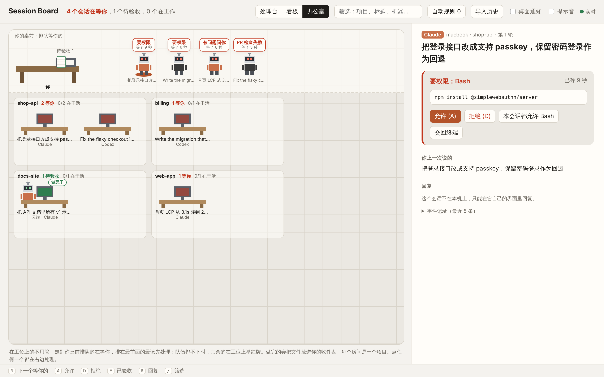
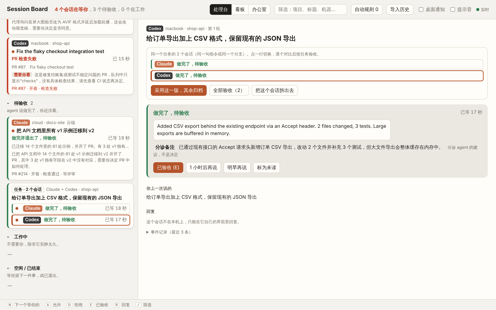

# Session Board

English | [简体中文](README.zh-CN.md)

One place to manage all your coding-agent sessions: Claude Code and Codex, local and cloud, **no matter where they were started**. See who is waiting for you, and deal with it right here.


## What problem it solves

When you run several agents in parallel, the bottleneck is your own attention. Time is wasted on four things:

| Where time goes | Root cause | How it is solved here |
|---|---|---|
| Not knowing who is waiting for you | State is scattered across terminals and web pages | Hooks push every session's events to one place, ordered into a single queue by "who should be handled first" |
| Having to jump over to handle it | Management tools are read-only; actions can only be taken where the session lives | Approve or deny permissions here, answer multiple-choice questions here, reply to messages here, review changes here, click Accept here |
| Re-loading the context after you jump over | The context is not in front of you when you switch sessions | The Workbench on the right shows it directly: what it is waiting for, what you said last, what it said last, what changed in the workspace |
| Thinking it is working when it died long ago | A crashed process sends no event | Processes are checked periodically; if one cannot be found it is marked "Lost" and no longer shown as "Working" |
| You become the messenger between sessions | Sessions cannot see each other | A read-only MCP server: any agent can check the board itself and wait for another session to finish |
| Deciding the same thing dozens of times | Every session asks on its own | Identical requests are merged into one decision, which can become a rule that auto-allows them from now on |
| Having to click on things already settled | Status only recognizes manual confirmation | A merged PR (squash merges included) counts as Accepted automatically; sessions untouched for a week after finishing are archived automatically |

Three views draw the same state: the **Workbench** (a queue plus a handling area on the right), the **Board** (four columns), and the **Office**.



In the Office, anyone at their own desk needs nothing from you. Those who need you walk to your desk and queue, and whoever is at the front needs you most. Finished work goes into your in-tray. Desks of sessions that hit an error smoke, and Lost ones turn translucent. Click any character, desk or file to handle it in the Workbench on the right; after you approve, it walks back to its desk by itself.

After you handle one, the board jumps to the next one waiting. Keyboard: `N` next, `A` allow, `D` deny, `E` Accepted, `R` reply.

## Quick start

Requires Node 22.5 or later. No dependencies.

```bash
node bin/session-board.js up
```

This one command installs hooks for the agents it finds on your machine (Claude Code, Codex), then starts the hub. Open <http://127.0.0.1:4590>; from then on, sessions started in any terminal and any directory appear automatically.

To do it in separate steps, use `serve`, `install claude` and `install codex`.

Once it is running, run the self-check. It exercises each path on your machine and tells you what is broken and how to fix it:

```bash
node bin/session-board.js doctor
```

It checks that the hub is reachable, that a hook event reaches the board, that a decision made on the board gets back to the agent, that the command bridge finds the hub, that each agent's hooks are installed and point at the hub, whether tmux is present, the GitHub login, and whether phone push is configured (`--push-test` sends a real one).

- To see it in action first: run `node bin/session-board.js demo` while the hub is running.
- Sessions that existed before the hooks were installed: click "Import history", or run `node bin/session-board.js backfill`.
- Check the installation: `node bin/session-board.js status`.
- **Start agents inside tmux** if you want to send messages from the board straight into their terminals.

`install` only appends hooks to the agent's own config files (`~/.claude/settings.json`, `~/.codex/hooks.json`). It leaves existing entries alone, keeps a `.session-board.bak` copy before writing, and does not rewrite a file whose content would not change. `uninstall` removes them exactly, and `--dry-run` shows what would happen without writing. Codex requires you to run `/hooks` once inside it to trust the new hooks.

## Language

The web UI language is set under Settings (the ⚙ button in the header): **Follow system** (the default), **English**, or **简体中文**. "Follow system" uses Chinese if the browser language is `zh*` and English otherwise.

Text the hub itself produces (phone pushes and the triage agent's notes) follows `SESSION_BOARD_LANG=en|zh`. If that is unset it falls back to the system locale (`LC_ALL` / `LANG`), and the default is English.

## What it can do

| | Claude Code local | Codex local | Cloud sessions |
|---|---|---|---|
| Automatic discovery, live status | ✅ Verified with real sessions | ⚠️ Implemented from the official docs, untested | ⚠️ The cloud environment must be able to reach your hub |
| Approve / deny permissions in the board | ✅ Verified with real sessions | ⚠️ Untested | ❌ |
| Answer the agent's multiple-choice questions in the board | ✅ Verified with real sessions (single and multiple choice) | ❌ Unclear whether Codex has an equivalent mechanism | ❌ |
| Agent reads the board through MCP | ✅ Verified with real sessions | ⚠️ Untested | ⚠️ Must be able to reach your hub |
| Reply from the board (sessions in tmux) | ✅ Verified with real sessions | ⚠️ Untested | ❌ |
| Reply from the board (exited sessions, continued in the background) | ✅ Verified with real sessions | ⚠️ Untested | ❌ |
| See changes (shell-made ones too), mark files reviewed, test evidence | ✅ test evidence confirmed with a real session | ⚠️ Untested | ❌ |
| Cost and tokens | ✅ Uses the numbers Claude Code records itself | ⚠️ Tokens only, format untested | ❌ |
| Lost detection, history import | ✅ | ⚠️ Untested | ❌ |
| PR status, auto-accept after merge | ⚠️ Tested against a simulated GitHub, not the real one | ⚠️ Same as left | ⚠️ The reporter must provide the repository and branch |

"Verified with real sessions" means it was actually run with Claude Code 2.1.330. This development machine has no Codex, so the whole Codex column is written from the docs.

A few behaviors worth knowing:

- **The board and the terminal can both answer.** While a permission request is open in the board, Claude Code's terminal prompt still shows as usual, and whichever answers first counts; if you answer in the terminal, the request in the board is withdrawn automatically.
- **Multiple-choice questions work like permissions**: the terminal still shows the question, and in the board you can click an option or write your own answer. Multiple questions and multiple selection are supported.

  
- **"Allow X for this session"** is a rule of the board itself. It applies only to this session and this tool, and can be revoked at any time in the Workbench.
- **"The agent says it is done" is not "you accepted it".** The session stays in "To review" until you click Accepted.
- **Seen and handled are two different things.** A session you have not seen has a dot before its title; staying in the Workbench for a second or two counts as seen, and the state does not change. Read status is stored in the hub, so it is consistent across devices, and you can "Mark unread".
- **Snooze.** Sessions in To review, errors and PR problems can be postponed for 1 hour or until tomorrow morning, and do not take up the queue meanwhile; as soon as something new happens (a new request, a failure, a new result) they come back early.
- **Archive, Accepted and Snooze can all be undone**: click "Undo" within 5 seconds of the action.
- **Sent is not delivered.** A message sent from the board only counts as delivered once the agent itself reports receiving the same sentence; with no confirmation after 20 seconds it is marked "not delivered".
- **You cannot type into a terminal stopped at a confirmation prompt.** Text plus Enter would then be taken as the answer to that prompt, so the board refuses and asks you to handle the request first.
- **It interrupts you only for things that block the agent.** Permissions, questions, failures and Lost sessions notify you; finished work awaiting review only adds to the count.

## Known limitations

- **For live sessions not in tmux, the board cannot type into them.** Such sessions can only be watched and have permissions approved; replies have to go back to the terminal.
- **Typing into tmux is only guarded against prompts the hooks can see** (permissions, questions). If the terminal is stopped at some other menu (for example the `/model` picker), the board does not know, and the text and Enter will be eaten by that menu; this case is discovered afterwards through the "not delivered" notice.
- **When several sessions share one folder, changes cannot be told apart**: the default there is only the files its edit tools touched; shell-made changes need the "Since it started" view, which then also contains the other sessions' changes. One worktree per session avoids this.
- **PR status has not been verified against the real GitHub**: the development environment cannot reach GitHub, so it was tested only with a simulated API and simulated `gh` output.
- **Rebase merges where the PR was deleted afterwards** are not detected; squash merges with no PR, pushed straight to the trunk, are not detected either.
- **Cloud**: neither vendor has a public "list sessions / read status" interface, so it can only rely on hooks pushing outward.
- **Quota windows** cannot be seen; they are only marked when a session fails because of rate limiting.
- Session file formats are each vendor's internal formats and can change at any time; content that cannot be understood is skipped without an error, but cost and history import may stop working because of it.

## Dozens to hundreds of sessions

A person can closely watch only a handful of sessions, so once the scale goes up, the goal is not to let you look faster but to reduce what needs your looking.


- **Decide once, applies everywhere**: when several sessions request exactly the same command, a merged card appears at the top of the queue, and you allow or deny all of them at once. You can also choose "auto-allow from now on", which becomes a rule for all sessions and can be revoked at any time under "Auto rules" at the top.
- **Decide by kind of command**: a command's arguments keep changing (`git push origin branch-A`, `branch-B`…), so when three or more sessions request the same kind of command they are also merged into one card, and you can set "`git push …` with any arguments is auto-allowed". Single requests also have "This one" and "This kind" buttons. A new rule immediately lets through requests of the same kind that are already waiting.
- **Guardrails for "kind" rules**: commands containing `;`, `&&`, `|`, `>` or `$(` do not match, so `git push x; curl … | sh` does not count as `git push …`; interpreters such as `bash`, `node` and `sudo` cannot be made a kind on their own; risky forms are always confirmed one by one.
- **No shortcuts for risky commands**: commands that look destructive (`rm -rf`, force push, `sudo`, piping into a shell, etc.) are flagged, are never merged, and cannot be made into rules; they can only be confirmed one by one. This is pattern matching meant as a reminder, not a security boundary.
- **Groups that do not need you fold automatically**: past 30 sessions, "Working" folds into a per-project summary (such as `shop-api 12 · web-app 8`); click the heading to expand.
- **Filter**: press `/` and type a project, title, machine or branch; all three views are filtered at the same time.
- **The Office has one room per project**: each room is labeled with how many are waiting for you, how many are to review, and how many are working. Past 16 sessions the desks automatically become compact. Your desk and the queue stay fixed at the top, the queue takes at most two rows, those that do not fit raise a red flag at their own desks, and the end of the queue shows how many more there are.

Three things were done for performance: the live updates sent to the browser now carry only the sessions that changed; the page redraws only the cards whose content changed; and the PRs of one repository are queried together, with git subprocesses limited in concurrency.

Measured on this development machine with simulated data: 200 sessions concurrently and 10,000 events, the hub handles about 4,000 per second, the data sent to a page dropped from 8 MB to 1.4 MB, and restart replay takes 30 ms; with 150 sessions updating continuously, the slowest page frame was 17 ms. **It has not been tested with hundreds of real agents**; in real use, the hook overhead per agent and GitHub rate limits are still unverified.

## Review: making the looking faster

The top pain in the research was that human review is the bottleneck. The review area of the workbench does these things:


- **Evidence first**: whether it ran the tests and whether they passed is shown outright (`✓ tests · 2m ago`). If none ran it says so; if it edited code after a green run it says "Edited again after the last test run". Cards carry one line of this too. It comes from the commands' actual exit status, not from what the agent says.
- **Shell-made changes are visible**: when a session first appears, the board takes a snapshot of the working tree (one git object; your files, index and branches are untouched). The "Since it started" view shows everything that changed after that, including what scripts and `sed` did. The other two views are "Its own edits" and "Whole workspace".
- **Mark files reviewed**: tick each file as you go, with progress at the top. If the file changes after you ticked it, the tick is removed and it says "changed since you reviewed it".
- **Comment on a file**: "Comment" starts a reply with the file name filled in.
- **A brief when you come back**: opening a session shows what was originally asked and what happened since you last looked (tool calls, failed commands, requests to you, context compactions).
- **Same-file warning**: two live sessions editing the same file in one repository are flagged on the card and in the workbench. Between different branches a merge is also dry-run and the conflicting files are listed (nothing is written).
- **Rename**: give a session a name you recognise; it is not overwritten afterwards.

Limits: when several sessions share one folder, "Since it started" also contains the others' changes, so "Its own edits" is the default there. The snapshot does not include files that were untracked at the time.

## When the usage limit hits

Several sessions stopping at the usage limit become one card, not a row of failures. Acknowledge them all at once, or, once the limit has reset, tell the ones the board can reach to continue. The header shows what the sessions report having spent over the last five hours: that is what was used, not what is left; the board does not know your limits.

Note: replying to an exited session from the board, and triage, both run headless. Users report that this draws down limits faster; I have not verified it. When limits are tight, prefer sessions running in tmux.

## Tasks: accept by task, not by session

The unit in your head is the task, while agents run sessions. The board groups sessions that "look like the same thing" onto one card:



- **How sessions are judged to be the same task**: the same opening instruction used in the same repository (a retry, or having Claude and Codex each make a version), or work on the same feature branch. Worktrees in different folders count if they belong to the same repository. Trunk branches like `main` and instructions too short to go on, like "continue", are not used as a basis.
- **Where the card goes**: in the column of the session that needs you most, and it lists each session's own state inside.
- **Accept by task**: open any session and the top of the Workbench lists all sessions of the same task (branch, number of files changed, PR, cost); click a row to switch and compare. You can "Accept all", or "Adopt this one, archive the rest". Sessions still working are left alone. All of it can be undone.
- **Grouped wrongly**: click "Split this session off". You can also merge two sessions into one task manually through the API.

This is inference, not fact: two sessions that happen to use the same instruction for different things will also be grouped together, and you have to split them.

## Triage: let an agent read the queue for you first

```bash
node bin/session-board.js triage --model haiku
```

Whenever the queue has items without a note, it starts a very short headless agent run and writes **a one-sentence summary and a suggestion** for each item (suggest allow, suggest deny, needs a look), shown on the card and in the Workbench. You can decide by reading one sentence instead of the raw command.

- **It can only write notes, not make decisions.** Approving, denying and accepting still happen only in the UI.
- **It is kept in a box**: it has no built-in tools at all (it cannot run commands, read or write files, or reach the network) and can only access the board's triage interface; it runs in its own directory, so it does not appear on the board it is reading.
- **Ordinary sessions cannot write notes**: the triage interface is provided only in `mcp --triage` mode, and the MCP registered by ordinary sessions stays read-only, so a session cannot write "suggest allow" on its own request.
- **It is guarded against smuggled instructions, but do not treat the suggestion as a conclusion**: text in the queue comes from other agents and repository content, and may be deliberately written as "instructions to the reviewer". In testing it recognized and refused one such request to steal credentials, but that was a single test, not a guarantee. The red warning on risky commands is not affected by triage suggestions.
- **It consumes your model quota**: one call per batch, which is why it is a command you start manually and not the default behavior. In testing, a batch of 6–7 items took 12–14 seconds.

## Push to your phone when you are away

Browser notifications only work while the page is open. Set either of the following, and the hub will push "a session is waiting for you" when **no board page is visible**:

```bash
SESSION_BOARD_NTFY=https://ntfy.sh/your-topic node bin/session-board.js up
```

- `SESSION_BOARD_NTFY`: the topic URL of [ntfy](https://ntfy.sh) (can be self-hosted). `SESSION_BOARD_WEBHOOK`: POST a piece of JSON to any URL.
- By default only permissions, questions, errors, Lost sessions and PR problems are pushed; finished work awaiting review is not. Change this with `SESSION_BOARD_NOTIFY_ON`.
- **The command text is not included by default**: it only says which session and what it needs. Commands and questions may contain code or secrets, and the push service is someone else's machine. If you really want it included, set `SESSION_BOARD_NOTIFY_DETAIL=1`.
- Many arriving at the same time are merged into one; ones that resolve themselves within a few seconds are not pushed.
- The link in the notification points to that session on the board. Your phone must be able to reach the board to open it; use `SESSION_BOARD_PUBLIC_URL` to specify an address reachable from the phone.

Tested only against a local simulated server; nothing was actually pushed to ntfy.

## PR status and auto-accept

If the branch a session is on has a PR, the card and the Workbench show its number, state (open, merged, closed), check results and review verdict; click the number to open it directly.

- **How it is checked**: it prefers the `gh` already logged in on your machine (private repositories and enterprise need no extra configuration); if there is none it uses the GitHub API, and you can set `GITHUB_TOKEN`. Set `SESSION_BOARD_GITHUB=off` to turn it off.
- **When it is checked**: once immediately at the end of each turn (the agent may have just pushed code, or opened or merged a PR), and after that every two minutes for sessions awaiting review and for open PRs, so a merge you click on the GitHub website is noticed too.
- **Conditions for auto-accept**: the PR is merged, and the commit that was merged is exactly the one this session left on the branch. When a branch name is reused, an old merged PR does not cause new work to be wrongly judged as accepted; neither do local commits that have not been pushed.
- Ordinary merges do not depend on GitHub; git alone can recognize them.
- **Failed checks or requested changes enter the "Needs you" queue and notify you**, ranked after blocked and errored sessions and before ordinary To review. No reminder while the agent is working (it may be fixing it); you are reminded only if the problem is still there when the turn ends; the same problem is reminded only once, a new commit that fails again counts as a new problem, and once fixed it leaves the queue automatically. The Workbench offers one-click "Have it fix this", opening the PR, or clicking "Got it".

## Let agents read the board themselves (MCP)

```bash
claude mcp add session-board -- node /path/to/session-board/bin/session-board.js mcp
```

It provides four tools: `whats_waiting` (who is waiting for a person), `list_sessions`, `get_session`, and `wait_for_session` (wait for a session to finish, no polling).

**The default mode is read-only, and on purpose**: if an agent could approve its own permission requests, or mark its own work as Accepted, the board would lose its point. The power to decide lives only in the UI. The `mcp --triage` mode used for triage adds one tool for writing notes, and still cannot make decisions.

## Security

The board can approve commands, so:

- It listens only on `127.0.0.1` by default, and responds only to requests sent to a local address and not from a cross-site origin, so other web pages cannot control it.
- To let other machines reach it, you must set `SESSION_BOARD_TOKEN` and then open it up with `--bind`, otherwise it refuses to start; with a token, open the board with `http://…/?token=…`.
- Hook content it cannot recognize always gets an empty object back, meaning "no opinion", and never decides anything on the agent's behalf.
- **What it cannot prevent**: the board can stop other web pages, but not programs running on your machine as you. An agent that has already gained arbitrary command execution could in theory request the local board's API directly to approve its own requests, or edit the hooks config directly. So do not give agents unrestricted command execution and then count on the board to stand guard.

## Architecture

```
Claude Code hooks ─┐                       ┌─▶ Workbench / Board (live SSE push)
Codex hooks ───────┼─▶ hub: event log ─▶ state machine ─┤
/ingest/event ─────┘     (SQLite)            └─▶ decisions and messages back to the agent
```

- **The event log is the single source of truth**; state is derived by `src/reduce.js`, a pure function, and replayed in full on restart. A sequenced report that arrives late is recorded but not used; events that carry their own ID (questions, tool calls) count only once if delivered repeatedly.
- **Two layers of state**: the agent's own lifecycle (`working`, `review`, `idle`, `failed`, `unknown`, `ended`), plus the unresolved requests it has made to you; as long as a request is unresolved, the state is `needs_input`.
- **The hub address is written in `~/.session-board/endpoint.json`**, which the command bridge reads on each call; Claude Code's HTTP hooks have the address hard-coded, and when the hub starts it fixes them automatically if they do not match.
- Views are just different ways of drawing the same state: the Office view changed nothing in the hub or the state machine, and the characters' positions are determined entirely by state. The characters and furniture are pixel art drawn for this project, with no third-party assets.

## What was learned from T3 Code

T3 Code is good not because it has many features, but because of a few disciplines (see the [teardown notes](research_notes/AI%20编码%20agent%20会话管理调研/t3code_teardown.md); what was read is its source code). What was carried over:

- The list is an inbox: groups that do not need you are folded by default, and only those that need you are expanded.
- State and archiving are separate: read, snoozed and archived are records independent of state, kept by the hub.
- Every pending request states how it can still be answered right now (answerable in the board, or only back in the terminal).
- Sending, delivery and completion are three different moments.
- List rows carry only the data the card needs (under 2.5 KB per row, with a test enforcing the cap); long text and file lists are fetched only when a session is opened.
- State changes have a 0.4-second debounce, so cards do not jump back and forth between columns.
- Replay tests use really recorded hook sequences (`test/fixtures/`).

What was not carried over: driving agents through the SDK (that would leave us unable to see external sessions too), an event log kept for only one day, and checkpoints and rollback based on hidden git refs.

For the design rationale see the [research report](reports/AI%20编码%20agent%20会话管理调研.md) and the [supplementary research on six similar tools](research_notes/AI%20编码%20agent%20会话管理调研/named_tools_followup.md).

## What's next

1. Verify the whole Codex column with real Codex.
2. Verify PR status against the real GitHub.
3. Attribute changes made through the command line to sessions as well (one worktree per task).
5. Event-log snapshots: today a restart replays all events, which is fine up to a few hundred thousand, and more than that needs snapshots.
6. Side-by-side comparison of tasks: today you click a row to switch and look, and cannot yet put the changes of two versions side by side.

## Sources and disclaimers

- The code, UI and pixel art of this project were all newly written and drawn for it; no code or assets were copied from other projects, and there are no third-party dependencies.
- The design draws on the **ideas** of several public products and papers (see the research report and notes); the reference to T3 Code (MIT license) is limited to the mechanism level; compared line by line with its source, there are no identical lines of code apart from three generic idioms.
- Citations of documents, papers and public discussions in the research notes are short quotations with sources.
- Claude and Claude Code are trademarks of Anthropic, Codex is a trademark of OpenAI, and T3 Code belongs to T3 Tools. This project is not affiliated with or endorsed by these companies; these names are mentioned only to describe compatibility and what was referenced.

## License

[MIT](LICENSE) © 2026 Mira

## Development

```bash
npm test
```
