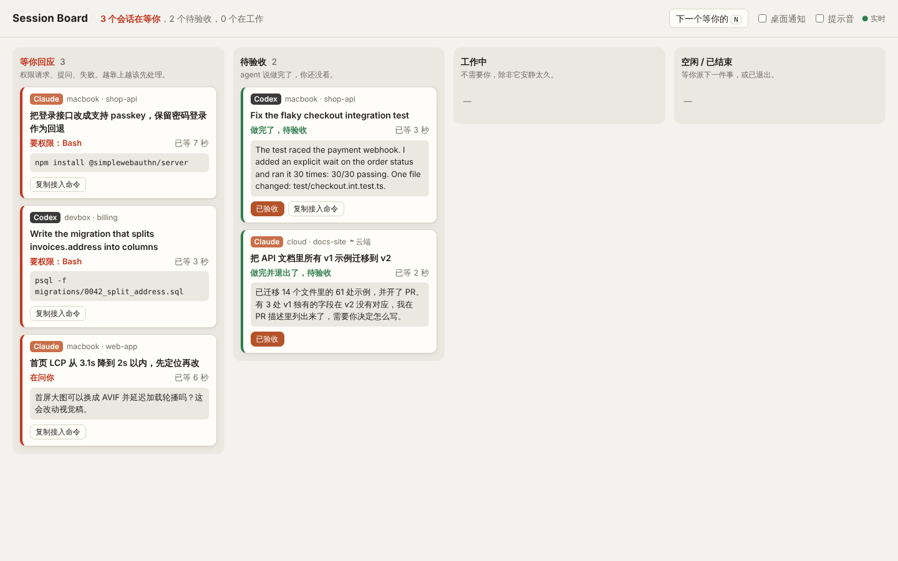

# Session Board

一个收件箱，管住你所有的编码 agent 会话：Claude Code 和 Codex，本地和云端，**不管是从哪里启动的**。



它回答一个问题：**现在哪个会话需要我？** 其余的都不用看。

## 快速开始

需要 Node 22.5 以上，没有任何依赖。

```bash
node bin/session-board.js serve
```

```bash
node bin/session-board.js install claude
```

```bash
node bin/session-board.js install codex
```

然后打开 <http://127.0.0.1:4590>。之后在任何终端、任何目录启动的 Claude Code / Codex 会话都会自动出现在看板上。想先看看效果，可以在 hub 运行时执行 `node bin/session-board.js demo`。

`install` 只往 agent 自己的配置文件（`~/.claude/settings.json`、`~/.codex/hooks.json`）里追加 hooks，不动你已有的 hooks，并留一份 `.session-board.bak` 备份；`uninstall` 原样移除。加 `--dry-run` 可以只看不写。Codex 要求你在它里面执行一次 `/hooks` 来信任新 hooks。

## 它怎么工作

```
Claude Code hooks ─┐
Codex hooks ───────┼─▶ hub：追加写入的事件日志 ─▶ 状态机 ─▶ 看板（SSE 实时推送）
其他来源 /ingest/event ┘      （SQLite）
```

- **事件日志是唯一事实来源。** 看板上的一切都由 `src/reduce.js` 这个纯函数从事件推导出来，重启时整体重放。以后的办公室视图只是同一份状态的另一种画法。
- **六个状态**：`working`、`needs_input`（权限 / 提问）、`review`、`idle`、`failed`、`ended`。
- **"agent 说做完了"不等于"你验收了"。** 一轮结束后会话停在"待验收"，只有你点"已验收"才离开，哪怕进程已经退出。
- **关注队列的排序是固定且可解释的**：权限请求 → 提问 → 失败 → 待验收，同级里等得最久的在前。按 `N` 跳到下一个。
- **只为阻塞 agent 的事打断你。** 权限、提问、失败会触发桌面通知和提示音；做完待验收只加计数，可以攒着一起看。
- **不知道就说不知道。** 工作中的会话超过 10 分钟没有任何事件，会被标出来："可能在跑长任务，也可能已经卡死或退出"。

## 第一版做了什么、没做什么

| 来源 | 发现 | 状态 | 需要你时通知 | 在看板里回复 / 批准 |
|---|---|---|---|---|
| Claude Code 本地 | ✅ 已用真实会话验证 | ✅ | ✅ | ❌ 复制 `claude --resume` 命令回到终端 |
| Codex 本地 | ⚠️ 按官方 hooks 文档实现，未用真实 Codex 验证 | ⚠️ | ⚠️ | ❌ |
| 云端会话 | ⚠️ 仅当云环境能访问到你的 hub，或自己往 `/ingest/event` 发事件 | ⚠️ | ⚠️ | ❌ |

第一版是**只读**的：hub 对每个 hook 都回空对象，从不替 agent 做决定。已知的限制：

- 权限请求这条路径只有单元测试和演示数据覆盖，没有在真实的交互式会话里验证过。
- 用户在终端里直接拒绝权限请求时，要等下一个事件（新的提问或一轮结束）看板才会更新。
- 两家云端都没有公开的"列出会话 / 读状态"接口，所以云端只能靠 hooks 往外推。
- hub 默认只监听 `127.0.0.1`。要让别的机器或云端会话上报，需要设置 `SESSION_BOARD_TOKEN` 并用 `--bind` 放开，否则拒绝启动。

## 为什么这样设计

设计依据见[调研报告](reports/AI%20编码%20agent%20会话管理调研.md)。最影响第一版的几条：

- 现有工具几乎都只能看到自己启动的会话，所以这里选择用 hooks 做被动聚合，而不是再做一个启动器。
- 一个人实际能并行监督的会话大约是 2–4 个，瓶颈在人的审查和上下文切换，所以卡片上直接放"它在等什么"和"它上一次说了什么"，尽量不用点进去。
- 这个品类一年内有多款产品停运或转向，所以第一版零依赖、单进程、本地优先，不绑定任何一家的私有格式（只用两家都文档化的 hooks）。

## 接下来

1. 在看板里批准 / 拒绝权限请求（Claude Code 的 `PermissionRequest` hook 支持从外部返回决定）。
2. 用真实 Codex 验证并补齐适配器。
3. 云端会话：GitHub 分支 / PR 作为旁路信号，把"待验收"和 PR 状态连起来。
4. 办公室视图：同一个状态机，等你的 agent 走到你桌前排队。

## 开发

```bash
npm test
```
