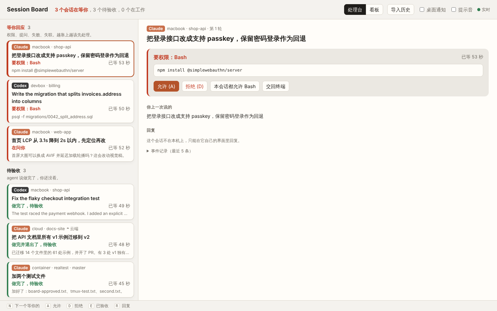
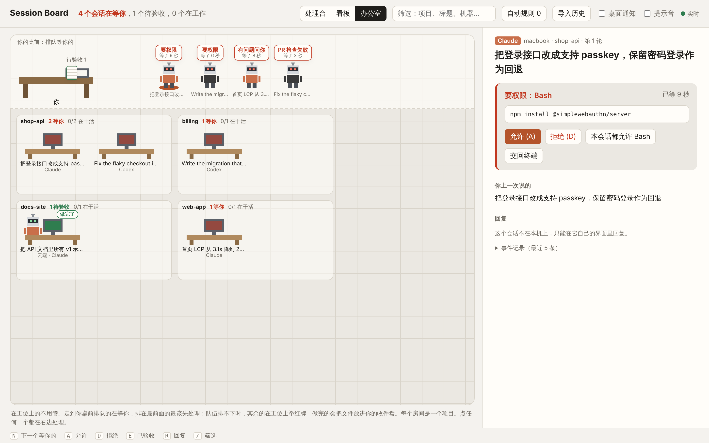
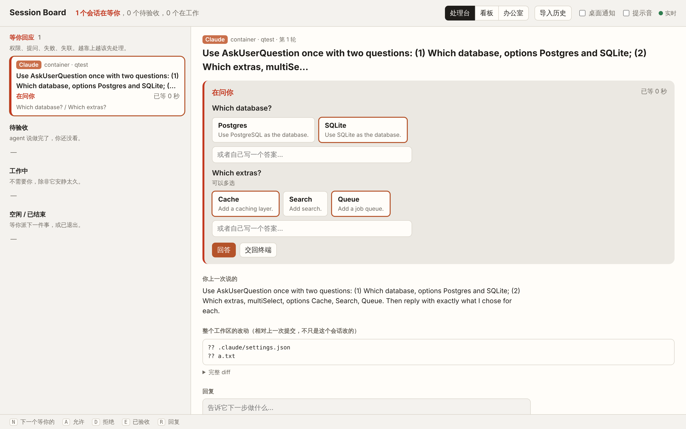
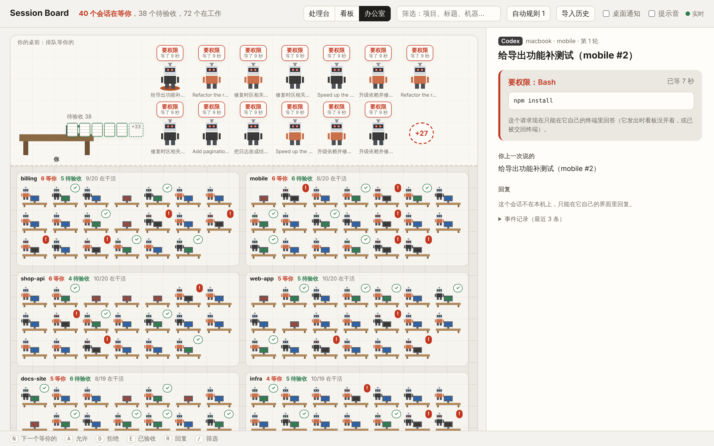
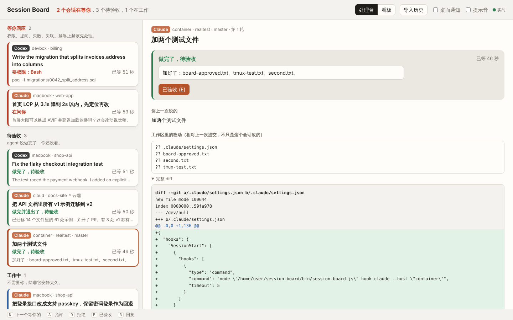
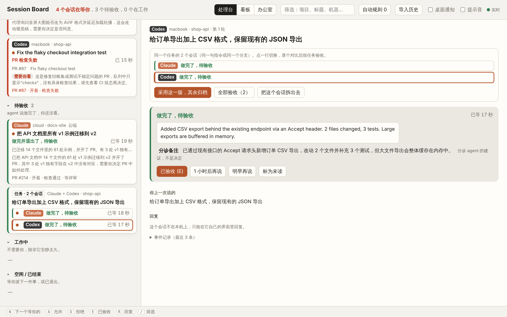

# Session Board

[English](README.md) | 简体中文

一个地方，管住你所有的编码 agent 会话：Claude Code 和 Codex，本地和云端，**不管是从哪里启动的**。看到谁在等你，并且就在这里把它处理掉。



## 它解决什么问题

并行跑多个 agent 时，瓶颈是你一个人的注意力。时间浪费在四件事上：

| 浪费在哪 | 根因 | 这里怎么解决 |
|---|---|---|
| 不知道谁在等你 | 状态散在各个终端和网页里 | hooks 把所有会话的事件推到一处，按“谁最该先处理”排成一个队列 |
| 知道了还得跳过去处理 | 管理工具只读，动作只能在原处做 | 权限在这里批准或拒绝，选择题在这里答，消息在这里回，改动在这里看，验收在这里点 |
| 跳过去要重新想起上下文 | 切换会话时上下文不在眼前 | 右侧处理台直接给出：它在等什么、你上次说了什么、它上次说了什么、工作区改了什么 |
| 以为在干活其实早死了 | 进程崩溃不会发事件 | 定期核对进程，找不到就标成“失联”，不再显示“工作中” |
| 你成了会话之间的传话人 | 会话互相看不见 | 只读的 MCP 服务：任何 agent 都能自己查看板、等另一个会话做完 |
| 同一件事要决定几十遍 | 每个会话各问各的 | 相同的请求合并成一次决定，可设为以后自动允许的规则 |
| 已经有定论的事还要你点一下 | 状态只认人工确认 | PR 合并了（包括 squash 合并）自动算验收，结束一周没人碰的自动归档 |

三种视图画的是同一份状态：**处理台**（队列加右侧处理区）、**看板**（四列）、**办公室**。



办公室里，在工位上的不用管；需要你的会走到你桌前排队，排在最前面的最该先处理；做完的把文件放进你的收件盘；出错的工位冒烟，失联的变成半透明。点任何一个角色、工位或文件，都在右边的处理台里处理，批准后它会自己走回工位。

处理完一个，自动跳到下一个等你的。键盘：`N` 下一个、`A` 允许、`D` 拒绝、`E` 已验收、`R` 回复。

## 快速开始

需要 Node 22.5 以上，没有任何依赖。

```bash
node bin/session-board.js up
```

这一条命令会给本机找到的 agent（Claude Code、Codex）装好 hooks，然后启动 hub。打开 <http://127.0.0.1:4590>，之后在任何终端、任何目录启动的会话都会自动出现。

想分开做，也可以用 `serve`、`install claude`、`install codex`。

装好后跑一次自检，它会在你的机器上实际走一遍每条链路，并告诉你哪里不通、怎么修：

```bash
node bin/session-board.js doctor
```

它检查：hub 是否可达、hook 事件能否到达看板、在看板做的决定能否回到 agent、命令桥能否找到 hub、两家 agent 的 hooks 是否装好且指向正确、有没有 tmux、GitHub 登录状态、手机推送是否配置（加 `--push-test` 真发一条）。

- 想先看效果：hub 运行时执行 `node bin/session-board.js demo`。
- 装 hooks 之前就存在的会话：点“导入历史”，或执行 `node bin/session-board.js backfill`。
- 检查安装情况：`node bin/session-board.js status`。
- **在 tmux 里启动 agent**，才能从看板直接往它的终端里发消息。

`install` 只往 agent 自己的配置文件（`~/.claude/settings.json`、`~/.codex/hooks.json`）里追加 hooks，不动已有的，写入前留一份 `.session-board.bak`；内容没变就不重写。`uninstall` 原样移除，`--dry-run` 只看不写。Codex 要求你在它里面执行一次 `/hooks` 来信任新 hooks。

## 语言

网页界面的语言在设置里选（页头的 ⚙ 按钮）：**跟随系统**（默认）、**English**、**简体中文**。“跟随系统”会在浏览器语言是 `zh*` 时用中文，否则用英文。

hub 自己生成的文字（手机推送、分诊 agent 的备注）由 `SESSION_BOARD_LANG=en|zh` 决定；没设置时按系统语言环境（`LC_ALL` / `LANG`）判断，默认英文。

## 能做到什么

| | Claude Code 本地 | Codex 本地 | 云端会话 |
|---|---|---|---|
| 自动发现、实时状态 | ✅ 真实会话验证 | ⚠️ 按官方文档实现，未实测 | ⚠️ 需云环境能访问你的 hub |
| 在看板里批准 / 拒绝权限 | ✅ 真实会话验证 | ⚠️ 未实测 | ❌ |
| 在看板里回答 agent 的选择题 | ✅ 真实会话验证（单选、多选） | ❌ 不清楚 Codex 是否有对应机制 | ❌ |
| agent 通过 MCP 读看板 | ✅ 真实会话验证 | ⚠️ 未实测 | ⚠️ 需能访问你的 hub |
| 从看板回复（tmux 里的会话） | ✅ 真实会话验证 | ⚠️ 未实测 | ❌ |
| 从看板回复（已退出的会话，后台续跑） | ✅ 真实会话验证 | ⚠️ 未实测 | ❌ |
| 看改动（含命令行改的）、逐文件标记已看、测试证据 | ✅ 测试证据经真实会话确认 | ⚠️ 未实测 | ❌ |
| 花费和 token | ✅ 取 Claude Code 自己记的数 | ⚠️ 只有 token，格式未实测 | ❌ |
| 失联检测、历史导入 | ✅ | ⚠️ 未实测 | ❌ |
| PR 状态、合并后自动验收 | ⚠️ 用模拟的 GitHub 测过，未连真实 GitHub | ⚠️ 同左 | ⚠️ 需上报方提供仓库和分支 |

“真实会话验证”指用 Claude Code 2.1.330 实际跑过。这台开发机没有 Codex，所以 Codex 一列全部是按文档写的。

几个值得知道的行为：

- **看板和终端同时可答。** 看板挂着权限请求时，Claude Code 的终端提示照常显示，谁先答谁算数；在终端答了，看板上的请求自动撤回。
- **选择题和权限一样**：终端照常显示题目，在看板里点选项或自己写答案都行，支持多题和多选。

  
- **“本会话都允许 X”** 是看板自己的规则，只对这个会话、这个工具生效，可随时在处理台里撤销。
- **“agent 说做完了”不等于“你验收了”。** 会话停在“待验收”，直到你点“已验收”。
- **看过和处理过是两回事。** 没看过的会话标题前有个圆点；在处理台里停留一两秒算看过，状态不变。已读存在 hub 里，换设备也一致，可以“标为未读”。
- **稍后处理。** 待验收、出错、PR 问题可以推迟 1 小时或到明早，期间不占队列；它一旦有新情况（新的请求、失败、新的结果）会提前回来。
- **归档、验收、推迟都能撤销**，操作后 5 秒内点“撤销”。
- **发出去不等于送达。** 从看板发的消息，要等 agent 自己报告收到同一句话才算送达；20 秒没确认会标成“未送达”。
- **终端停在确认提示上时不能往里打字。** 那时的文字加回车会被当成对提示的回答，所以看板会拒绝，要求先处理请求。
- **只为阻塞 agent 的事打断你。** 权限、提问、失败、失联会通知；做完待验收只加计数。

## 已知限制

- **不在 tmux 里的活会话，看板没法往里打字。** 这类会话只能看、能批权限，回复要回终端。
- **往 tmux 里打字只防得住 hooks 看得见的提示**（权限、提问）。终端停在别的菜单上时（比如 `/model` 选择器），看板不知道，文字和回车会被那个菜单吃掉；这种情况靠“未送达”提示事后发现。
- **多个会话共用一个文件夹时，同一时刻跑的两条命令分不清**：共用文件夹时，看板会在每条命令前后各看一眼工作区，把变化记到跑这条命令的会话名下。两个会话的命令恰好同时在跑，这段时间里的改动会同时记到两边。
- **PR 状态没有对着真实 GitHub 验证过**：开发环境连不上 GitHub，只用模拟的接口和模拟的 `gh` 输出测过。
- **rebase 合并且之后删了 PR 的情况**检测不到；没有 PR、直接推主干的 squash 也检测不到。
- **云端**：两家都没有公开的“列出会话 / 读状态”接口，只能靠 hooks 往外推。
- **额度窗口要装状态栏转发才看得到**（见下），而且只有订阅用户才有这份数据；Codex 的额度看不到。
- 会话文件格式是各家的内部格式，随时可能变；读不懂的内容会被跳过，不会报错，但花费和历史导入可能因此失效。

## 几十到上百个会话

一个人能逐个盯住的会话只有几个，所以规模上去以后，目标不是让你看得更快，而是让需要你看的东西变少。



- **决定一次，处处生效**：多个会话请求完全相同的命令时，队列顶部出现一张合并卡片，一次全部允许或拒绝。也可以选“以后也自动允许”，变成对所有会话生效的规则，在顶部“自动规则”里随时撤销。
- **按一类命令决定**：命令的参数总在变（`git push origin 分支A`、`分支B`…），所以三个以上会话请求同一类命令时也会合并成一张卡片，可以设成“`git push …` 加任意参数都自动允许”。单个请求上也有“这一条”和“这一类”两个按钮。新规则会立刻放行已经在等的同类请求。
- **“一类”规则的护栏**：带 `;`、`&&`、`|`、`>`、`$(` 的命令不会匹配，所以 `git push x; curl … | sh` 不算 `git push …`；`bash`、`node`、`sudo` 这类解释器不能单独设成一类；高风险写法永远逐个确认。
- **高风险命令不走捷径**：看起来有破坏性的命令（`rm -rf`、强制推送、`sudo`、管道进 shell 等）会标出来，不会被合并，也不能设成规则，只能逐个确认。这是一个提醒用的模式匹配，不是安全边界。
- **不需要你的分组自动折叠**：超过 30 个会话时，“工作中”折叠成按项目的汇总（如 `shop-api 12 · web-app 8`），点标题展开。
- **筛选**：按 `/` 输入项目、标题、机器或分支，三个视图同时过滤。
- **办公室按项目分房间**：每个房间标着几个在等你、几个待验收、多少在干活。超过 16 个会话时工位自动变紧凑。你的桌子和队伍固定在最上面，队伍最多排两行，排不下的在各自工位上举红牌，队尾显示还有多少个。

性能上做了三件事：给浏览器的实时更新改成只发变化的会话；页面只重画内容变了的卡片；同一个仓库的 PR 一次查完，git 子进程限制并发。

在这台开发机上用模拟数据量过：200 个会话并发、1 万条事件，hub 每秒处理约 4000 条，发给一个页面的数据从 8 MB 降到 1.4 MB，重启重放 30 毫秒；150 个会话持续更新时页面最慢一帧 17 毫秒。**没有用上百个真实 agent 测过**，真实场景下每个 agent 的 hook 开销、GitHub 限流都还没验证。

## 审查：让“看”这件事变快

调研里排第一的痛点是人工审查成了瓶颈。处理台的审查区做了这几件事：



- **先看证据**：它跑没跑测试、过没过，直接显示（`✓ 测试 · 2 分钟前`）。没跑过会写“没见它跑过测试”；测试通过之后又改了代码，会提示“最后一次测试之后又改了代码”。卡片上也有一行。这是从命令的实际退出状态得来的，不是它自己说的。
- **命令行改的也看得到**：会话第一次出现时，看板给工作区拍一个快照（只写一个 git 对象，不动你的文件、暂存区和分支）。“会话开始以来”这个视图显示从那以后的全部改动，包括脚本和 `sed` 改的。另外两个视图是“它自己编辑的”和“整个工作区”。
- **逐文件标记已看**：每个文件可以勾“已看”，顶部显示进度。你看过之后它又改了这个文件，勾会自动取消并标出“你看过之后又改了”。
- **对文件提意见**：点“提意见”把文件名带进回复框。
- **回来时的简报**：打开一个会话，会看到最初的要求，以及你上次看过之后发生了什么（调用了几次工具、几条命令失败、向你请求了几次、上下文被压缩了几次）。
- **改同一个文件的预警**：两个正在进行的会话在同一个仓库里改同一个文件，卡片和处理台都会提示。不同分支之间还会试算合并，会冲突就列出文件（只是试算，不写入任何东西）。
- **改名**：给会话起个你认得的名字，之后不会被自动覆盖。

限制：同一个文件夹里同时有多个会话时，“会话开始以来”会混进别的会话的改动，这时默认显示“它自己编辑的”。快照不包含当时未跟踪的新文件。

## 被限流时

多个会话因用量上限停下，会合并成一张卡片，而不是一排失败。可以一次全部知悉，或者等额度恢复后一键让看板联系得上的那些“继续”。顶部显示近 5 小时各会话自己报告的花费总和：这是已经用掉的，不是还剩多少，看板不知道你的额度上限。

注意：从看板回复已退出的会话、以及分诊，走的都是无界面运行。有用户报告这种方式扣订阅额度更快，这一点我验证不了。我做过一次对照：同一句话，无界面花费 $0.0445，交互式 $0.1604，没有看出无界面在 token 上更贵，但只测了一次，而且无界面那次碰巧用上了缓存。

## 任务：按任务验收，而不是按会话

你脑中的单位是任务，agent 跑的是会话。看板把“看起来是同一件事”的会话归到一张卡片上：



- **怎么认定是同一个任务**：同一个仓库里用了同一句开场指令（重试，或者让 Claude 和 Codex 各做一版），或者在同一个功能分支上干活。不同文件夹的 worktree 只要是同一个仓库也算。`main` 这类主干分支、“继续”这种太短的指令不算依据。
- **卡片放在哪**：放在它最需要你的那个会话所在的一栏，里面列出每个会话各自的状态。
- **按任务验收**：打开任一会话，处理台顶部列出同任务的所有会话（分支、改了几个文件、PR、花费），点一行切换对比。可以“全部验收”，或“采用这一版，其余归档”。还在干活的会话不会被动。都能撤销。
- **认错了**：点“把这个会话拆出去”。也可以通过接口手动把两个会话并成一个任务。

这是推断，不是事实：两个会话恰好用了同一句指令做不同的事，也会被归到一起，需要你拆开。

## 分诊：让一个 agent 先替你读一遍队列

```bash
node bin/session-board.js triage --model haiku
```

它会在队列里出现没有备注的项时，启动一次很短的无界面 agent 运行，给每一项写**一句话摘要和一个建议**（建议允许、建议拒绝、需要你看），显示在卡片和处理台上。你读一句话就能决定，不用读命令原文。

- **它只能写备注，不能做决定。** 批准、拒绝、验收仍然只在界面上。
- **它被关在盒子里**：没有任何内置工具（不能跑命令、不能读写文件、不能上网），只能访问看板的分诊接口；它在自己的目录里运行，不会出现在它正在读的看板上。
- **普通会话写不了备注**：分诊接口只在 `mcp --triage` 模式下提供，普通会话注册的 MCP 仍是只读的，所以一个会话没法给自己的请求写“建议允许”。
- **对夹带指令有防备，但别把建议当结论**：队列里的文字来自其他 agent 和仓库内容，可能故意写成“给审阅者的指令”。实测中它识别并拒绝了这样一条窃取凭据的请求，但这只是一次测试，不是保证。高风险命令的红色警示不受分诊建议影响。
- **它会消耗你的模型额度**：每批一次调用，所以是你手动开启的命令，不是默认行为。实测 6–7 项一批用时 12–14 秒。

## 额度窗口和上下文占用

Claude Code 只在一个地方给出“已用多少、何时重置”：传给状态栏脚本的数据。所以这是可选的一步：

```bash
node bin/session-board.js install claude --statusline
```

装上后，看板顶部显示 5 小时窗口和每周窗口的已用百分比与重置时间（超过 70% 变色，超过 90% 标红），每个会话显示上下文占用，超过 85% 会在卡片上提醒它快要被压缩了。

- 你原来的状态栏不会丢：转发器收到数据后，会用同样的输入运行你原来的命令并显示它的输出。`uninstall claude --statusline` 原样恢复。
- 只有 claude.ai 订阅用户才有额度数据；用 API key 时只有上下文占用。
- 用真实会话验证过：这个开发环境里拿到了“本周已用 27%”和重置时间。

## Codex

这一列大部分仍是按文档和它的程序本身核对的，没有用登录后的真实会话跑过。在这里装了 Codex 0.171 确认了：

- 它的程序里有我们用到的 hook 事件名和字段名，`codex resume`、`codex exec resume` 两条命令存在。
- **回复不需要 tmux**：Codex 有官方的 `codex queue`，看板用它给已有会话排消息。
- **它没有“命令失败”事件**：所以 Codex 会话的测试证据只在它的回应里带明确退出码时才显示，不会把失败显示成通过。
- **Codex 云端任务（可选，默认关）**：设 `SESSION_BOARD_CODEX_CLOUD=1` 后，hub 每两分钟用官方命令 `codex cloud list --json` 列一次云端任务并显示出来。这是正规途径，不碰私有接口。但那份 JSON 的格式没有文档，这里也没法登录验证，所以读取是按常见字段名宽松匹配的；先跑 `node bin/session-board.js codex-cloud` 看看它把你的真实数据读成了什么。

## 另一台机器上的会话

```bash
node bin/session-board.js remote 那台机器的-ssh-名字
```

它会打印一段 hooks 配置（只用 HTTP，那台机器不需要装 session-board），并开一条 SSH 反向隧道：那台机器上的 agent 只往自己的 `localhost` 发，隧道把它带到你的 hub。没有中继服务，也不对外开端口。

- 能做：看到那些会话，批准和回答它们的请求。
- 不能做：回复、看改动、PR 状态，这些需要文件在本机。
- 没有用真实的两台机器测过，只测了生成的配置。

## 离开电脑时推送到手机

浏览器通知要开着页面才有。设置下面任意一个，hub 会在**没有任何看板页面处于可见状态**时，把“有会话在等你”推出去：

```bash
SESSION_BOARD_NTFY=https://ntfy.sh/你的主题 node bin/session-board.js up
```

- `SESSION_BOARD_NTFY`：[ntfy](https://ntfy.sh) 的主题地址（可自建）。`SESSION_BOARD_WEBHOOK`：向任意地址 POST 一段 JSON。
- 默认只推权限、提问、出错、失联和 PR 问题；做完待验收不推。用 `SESSION_BOARD_NOTIFY_ON` 改。
- **默认不带命令原文**：只说哪个会话、需要什么。命令和问题里可能有代码或密钥，而推送服务是别人的机器。确实想带上，设 `SESSION_BOARD_NOTIFY_DETAIL=1`。
- 同时来很多个会合并成一条；几秒内自己解决了的不推。
- 通知里的链接指向看板上的那个会话。手机要能访问到看板才点得开，用 `SESSION_BOARD_PUBLIC_URL` 指定手机可达的地址。

只用本地的模拟服务测过，没有真的推到 ntfy。

## PR 状态和自动验收

会话所在分支如果有 PR，卡片和处理台上会显示它的编号、状态（开着、已合并、已关闭）、检查结果和评审结论，点编号直接打开。

- **怎么查**：优先用你机器上已登录的 `gh`（私有仓库、企业版都不用额外配置）；没有就走 GitHub 接口，可设 `GITHUB_TOKEN`。设 `SESSION_BOARD_GITHUB=off` 关闭。
- **什么时候查**：每轮结束时立刻查一次（agent 可能刚推了代码、开了或合了 PR），之后对待验收的会话和开着的 PR 每两分钟查一次，所以你在 GitHub 网页上点合并也能被发现。
- **自动验收的条件**：PR 已合并，并且被合并的正是这个会话留在分支上的那个提交。分支名被复用时，旧的已合并 PR 不会让新的工作被误判为已验收；本地还有没推上去的提交时也不会。
- 普通合并不依赖 GitHub，单靠 git 就能识别。
- **检查失败或被要求修改会进“等你回应”队列并通知**，排在被卡住和出错的会话之后、普通待验收之前。agent 正在干活时不提醒（它可能正在修），等这一轮结束问题还在才提醒；同一个问题只提醒一次，新的提交再失败算新问题；修好了自动离开队列。处理台上可以一键“让它去修”、打开 PR，或点“知道了”。

## 让 agent 自己读看板（MCP）

```bash
claude mcp add session-board -- node /path/to/session-board/bin/session-board.js mcp
```

提供四个工具：`whats_waiting`（谁在等人）、`list_sessions`、`get_session`、`wait_for_session`（等某个会话做完，不用轮询）。

**默认模式是只读的，而且是故意的**：如果 agent 能批准自己的权限请求，或者把自己的活标成已验收，看板就失去意义了。决定权只在界面上。分诊用的 `mcp --triage` 模式多一个写备注的工具，仍然不能做决定。

## 安全

看板能批准命令，所以：

- 默认只监听 `127.0.0.1`，并且只响应发往本机地址、且不是跨站来源的请求，其他网页无法操控它。
- 要让别的机器访问，必须设置 `SESSION_BOARD_TOKEN` 再用 `--bind` 放开，否则拒绝启动；带 token 时用 `http://…/?token=…` 打开看板。
- 无法识别的 hook 内容一律回空对象，即“没有意见”，不会替 agent 做决定。
- **防不住的情况**：看板挡得住别的网页，挡不住本机上以你的身份运行的程序。一个已经拿到任意命令执行权限的 agent，理论上可以直接请求本机的看板接口来批准自己的请求，也可以直接改掉 hooks 配置。所以不要给 agent 开放不受限制的命令执行，再指望看板把关。

## 架构

```
Claude Code hooks ─┐                       ┌─▶ 处理台 / 看板（SSE 实时推送）
Codex hooks ───────┼─▶ hub：事件日志 ─▶ 状态机 ─┤
/ingest/event ─────┘     （SQLite）            └─▶ 决定和消息回到 agent
```

- **事件日志是唯一事实来源**，状态由 `src/reduce.js` 这个纯函数推导，重启时整体重放。带序号的上报如果迟到，会被记录但不采用；自带 ID 的事件（提问、工具调用）重复送达只算一次。
- **两层状态**：agent 自己的生命周期（`working`、`review`、`idle`、`failed`、`unknown`、`ended`），加上它向你提出的未解决请求；只要有请求未解决，就是 `needs_input`。
- **hub 地址写在 `~/.session-board/endpoint.json`**，命令桥每次调用时读取；Claude Code 的 HTTP hooks 写死了地址，hub 启动时发现不一致会自动改回来。
- 视图只是同一份状态的不同画法：办公室视图没有改动 hub 和状态机，角色位置完全由状态决定。角色和家具是本项目自己画的像素图，没有用任何第三方素材。

## 从 T3 Code 学到的

T3 Code 好用，靠的不是功能多，而是几条纪律（详见[拆解笔记](research_notes/AI%20编码%20agent%20会话管理调研/t3code_teardown.md)，读的是它的源码）。搬过来的：

- 列表是收件箱：不需要你的分组默认折叠，只有需要你的才展开。
- 状态和归档分开：已读、稍后处理、归档是独立于状态的记录，由 hub 保存。
- 每个待处理请求都标明现在还能怎么回答（看板可答，或只能回终端）。
- 发送、送达、完成是三个不同的时刻。
- 列表行只带卡片需要的数据（每行不到 2.5 KB，有测试卡住上限），长文本和文件列表在打开会话时才取。
- 状态变化有 0.4 秒的防抖，避免卡片在两列之间来回跳。
- 用真实录制的 hook 序列做回放测试（`test/fixtures/`）。

没搬的：通过 SDK 驱动 agent（那会让我们也看不到外部会话）、只保留一天的事件日志、基于隐藏 git 引用的检查点和回滚。

设计依据见[调研报告](reports/AI%20编码%20agent%20会话管理调研.md)和[六个同类工具的补充调研](research_notes/AI%20编码%20agent%20会话管理调研/named_tools_followup.md)。

## 接下来

1. 用真实 Codex 验证整列能力。
2. 对着真实 GitHub 验证 PR 状态。
3. 把命令行造成的改动也归属到会话（每个任务一个 worktree）。
5. 事件日志快照：现在重启时重放全部事件，几十万条以内没问题，再多需要快照。
6. 任务的并排对比：现在是点一行切换着看，还不能把两个版本的改动并排放。

## 来源与声明

- 本项目的代码、界面和像素图都是为本项目新写、新画的，没有复制其他项目的代码或素材，也没有任何第三方依赖。
- 设计上参考了多个公开产品和论文的**思路**（见调研报告和笔记），其中对 T3 Code（MIT 许可）的参考只限于机制层面；与它的源码逐行比对过，除三行通用写法外没有相同的代码行。
- 调研笔记里对文档、论文和公开讨论的引用都是带出处的短句。
- Claude、Claude Code 是 Anthropic 的商标，Codex 是 OpenAI 的商标，T3 Code 属于 T3 Tools。本项目与这些公司没有关联，也未获其认可；提到这些名字只是为了说明兼容和参考对象。

## 许可证

[MIT](LICENSE) © 2026 Mira

## 开发

```bash
npm test
```
